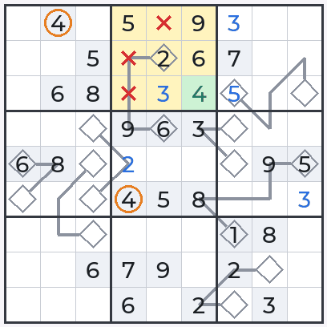

<!-- Written by tools/walkthrough.py lockout-lines: edit the script, not this page. -->
# Lockout Lines, step 6: the 4 in box 2

**Step 6 of 53** · [← Step 5](step-05.md) · [All steps](../lockout-lines.md#the-whole-puzzle-step-by-step) · [Step 7 →](step-07.md)

Box 2 needs a 4. r1c5: row 1 has one (r1c2). r2c4 and r3c4: column 4 has one (r6c4). Only **r3c6** is left: **r3c6 = 4**.

**Step 6 of 53** · [← Step 5](step-05.md) · [All steps](../lockout-lines.md#the-whole-puzzle-step-by-step) · [Step 7 →](step-07.md)
