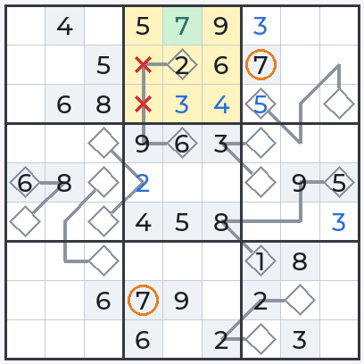

<!-- Written by tools/walkthrough.py lockout-lines: edit the script, not this page. -->
# Lockout Lines, step 7: the 7 in box 2

**Step 7 of 53** · [← Step 6](step-06.md) · [All steps](../lockout-lines.md#the-whole-puzzle-step-by-step) · [Step 8 →](step-08.md)

Box 2 needs a 7. r2c4: row 2 has one (r2c7). r3c4: column 4 has one (r8c4). Only **r1c5** is left: **r1c5 = 7**.

**Step 7 of 53** · [← Step 6](step-06.md) · [All steps](../lockout-lines.md#the-whole-puzzle-step-by-step) · [Step 8 →](step-08.md)
