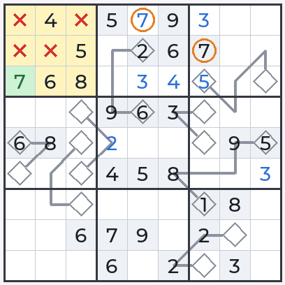

<!-- Written by tools/walkthrough.py lockout-lines: edit the script, not this page. -->
# Lockout Lines, step 8: the 7 in box 1

**Step 8 of 53** · [← Step 7](step-07.md) · [All steps](../lockout-lines.md#the-whole-puzzle-step-by-step) · [Step 9 →](step-09.md)

Box 1 needs a 7. r1c1 and r1c3: row 1 has one (r1c5). r2c1 and r2c2: row 2 has one (r2c7). Only **r3c1** is left: **r3c1 = 7**.

**Step 8 of 53** · [← Step 7](step-07.md) · [All steps](../lockout-lines.md#the-whole-puzzle-step-by-step) · [Step 9 →](step-09.md)
