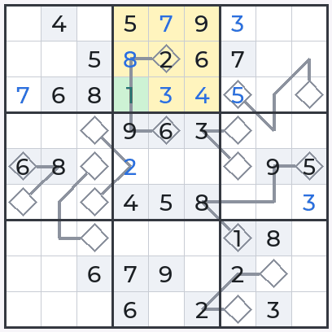

<!-- Written by tools/walkthrough.py lockout-lines: edit the script, not this page. -->
# Lockout Lines, step 10: the 1 in box 2

**Step 10 of 53** · [← Step 9](step-09.md) · [All steps](../lockout-lines.md#the-whole-puzzle-step-by-step) · [Step 11 →](step-11.md)

Box 2 needs a 1, and r3c4 is its last empty cell: **r3c4 = 1**.

**Step 10 of 53** · [← Step 9](step-09.md) · [All steps](../lockout-lines.md#the-whole-puzzle-step-by-step) · [Step 11 →](step-11.md)
