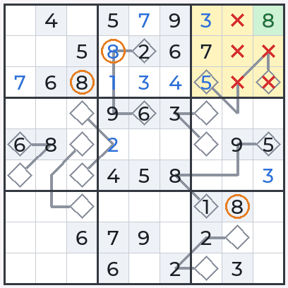

<!-- Written by tools/walkthrough.py lockout-lines: edit the script, not this page. -->
# Lockout Lines, step 11: the 8 in box 3

**Step 11 of 53** · [← Step 10](step-10.md) · [All steps](../lockout-lines.md#the-whole-puzzle-step-by-step) · [Step 12 →](step-12.md)

Box 3 needs an 8. r1c8: column 8 has one (r7c8). r2c8 and r2c9: row 2 has one (r2c4). r3c8 and r3c9: row 3 has one (r3c3). Only **r1c9** is left: **r1c9 = 8**.

**Step 11 of 53** · [← Step 10](step-10.md) · [All steps](../lockout-lines.md#the-whole-puzzle-step-by-step) · [Step 12 →](step-12.md)
