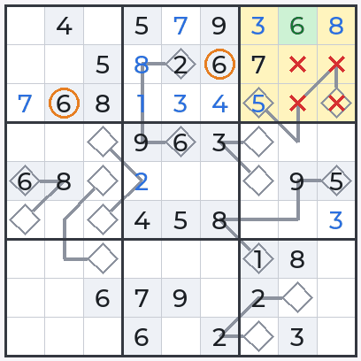

<!-- Written by tools/walkthrough.py lockout-lines: edit the script, not this page. -->
# Lockout Lines, step 12: the 6 in box 3

**Step 12 of 53** · [← Step 11](step-11.md) · [All steps](../lockout-lines.md#the-whole-puzzle-step-by-step) · [Step 13 →](step-13.md)

Box 3 needs a 6. r2c8 and r2c9: row 2 has one (r2c6). r3c8 and r3c9: row 3 has one (r3c2). Only **r1c8** is left: **r1c8 = 6**.

**Step 12 of 53** · [← Step 11](step-11.md) · [All steps](../lockout-lines.md#the-whole-puzzle-step-by-step) · [Step 13 →](step-13.md)
