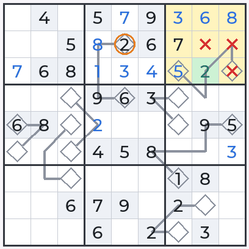

<!-- Written by tools/walkthrough.py lockout-lines: edit the script, not this page. -->
# Lockout Lines, step 13: the 2 in box 3

**Step 13 of 53** · [← Step 12](step-12.md) · [All steps](../lockout-lines.md#the-whole-puzzle-step-by-step) · [Step 14 →](step-14.md)

Box 3 needs a 2. r2c8 and r2c9: row 2 has one (r2c5). r3c9: it's a diamond, and a 2 is less than 4 away from the 5 in the other diamond. Only **r3c8** is left: **r3c8 = 2**.

**Step 13 of 53** · [← Step 12](step-12.md) · [All steps](../lockout-lines.md#the-whole-puzzle-step-by-step) · [Step 14 →](step-14.md)
