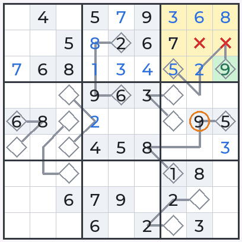

<!-- Written by tools/walkthrough.py lockout-lines: edit the script, not this page. -->
# Lockout Lines, step 14: the 9 in box 3

**Step 14 of 53** · [← Step 13](step-13.md) · [All steps](../lockout-lines.md#the-whole-puzzle-step-by-step) · [Step 15 →](step-15.md)

Box 3 needs a 9. r2c8: column 8 has one (r5c8). r2c9: it's between the diamonds of its line, and a 9 couldn't lie outside their range. Only **r3c9** is left: **r3c9 = 9**.

**Step 14 of 53** · [← Step 13](step-13.md) · [All steps](../lockout-lines.md#the-whole-puzzle-step-by-step) · [Step 15 →](step-15.md)
