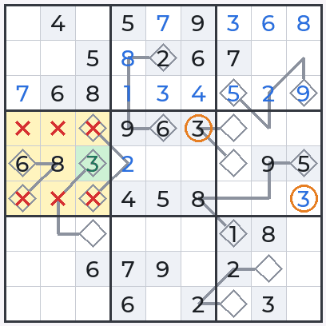

<!-- Written by tools/walkthrough.py lockout-lines: edit the script, not this page. -->
# Lockout Lines, step 15: the 3 in box 4

**Step 15 of 53** · [← Step 14](step-14.md) · [All steps](../lockout-lines.md#the-whole-puzzle-step-by-step) · [Step 16 →](step-16.md)

Box 4 needs a 3. r4c1, r4c2 and r4c3: row 4 has one (r4c6). r6c1, r6c2 and r6c3: row 6 has one (r6c9). Only **r5c3** is left: **r5c3 = 3**.

**Step 15 of 53** · [← Step 14](step-14.md) · [All steps](../lockout-lines.md#the-whole-puzzle-step-by-step) · [Step 16 →](step-16.md)
