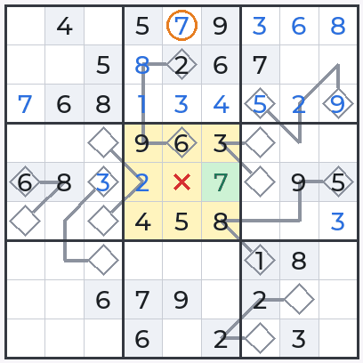

<!-- Written by tools/walkthrough.py lockout-lines: edit the script, not this page. -->
# Lockout Lines, step 16: the 7 in box 5

**Step 16 of 53** · [← Step 15](step-15.md) · [All steps](../lockout-lines.md#the-whole-puzzle-step-by-step) · [Step 17 →](step-17.md)

Box 5 needs a 7. r5c5: column 5 has one (r1c5). Only **r5c6** is left: **r5c6 = 7**.

**Step 16 of 53** · [← Step 15](step-15.md) · [All steps](../lockout-lines.md#the-whole-puzzle-step-by-step) · [Step 17 →](step-17.md)
