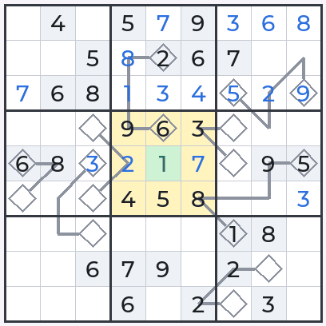

<!-- Written by tools/walkthrough.py lockout-lines: edit the script, not this page. -->
# Lockout Lines, step 17: the 1 in box 5

**Step 17 of 53** · [← Step 16](step-16.md) · [All steps](../lockout-lines.md#the-whole-puzzle-step-by-step) · [Step 18 →](step-18.md)

Box 5 needs a 1, and r5c5 is its last empty cell: **r5c5 = 1**.

**Step 17 of 53** · [← Step 16](step-16.md) · [All steps](../lockout-lines.md#the-whole-puzzle-step-by-step) · [Step 18 →](step-18.md)
