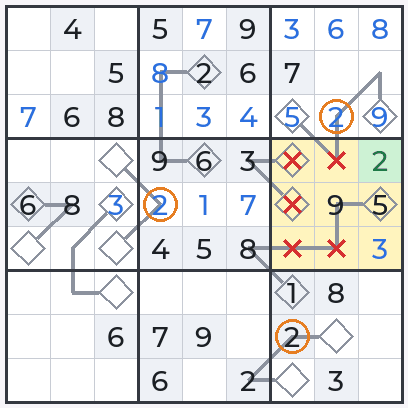

<!-- Written by tools/walkthrough.py lockout-lines: edit the script, not this page. -->
# Lockout Lines, step 18: the 2 in box 6

**Step 18 of 53** · [← Step 17](step-17.md) · [All steps](../lockout-lines.md#the-whole-puzzle-step-by-step) · [Step 19 →](step-19.md)

Box 6 needs a 2. r4c7 and r6c7: column 7 has one (r8c7). r4c8 and r6c8: column 8 has one (r3c8). r5c7: row 5 has one (r5c4). Only **r4c9** is left: **r4c9 = 2**.

**Step 18 of 53** · [← Step 17](step-17.md) · [All steps](../lockout-lines.md#the-whole-puzzle-step-by-step) · [Step 19 →](step-19.md)
