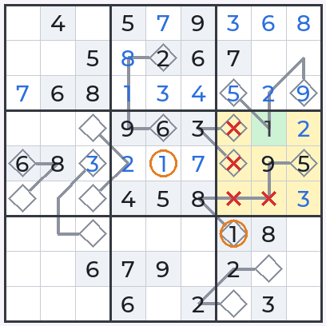

<!-- Written by tools/walkthrough.py lockout-lines: edit the script, not this page. -->
# Lockout Lines, step 19: the 1 in box 6

**Step 19 of 53** · [← Step 18](step-18.md) · [All steps](../lockout-lines.md#the-whole-puzzle-step-by-step) · [Step 20 →](step-20.md)

Box 6 needs a 1. r4c7 and r6c7: column 7 has one (r7c7). r5c7: row 5 has one (r5c5). r6c8: it's between the diamonds 1 and 5, so it's above 5. Only **r4c8** is left: **r4c8 = 1**.

**Step 19 of 53** · [← Step 18](step-18.md) · [All steps](../lockout-lines.md#the-whole-puzzle-step-by-step) · [Step 20 →](step-20.md)
