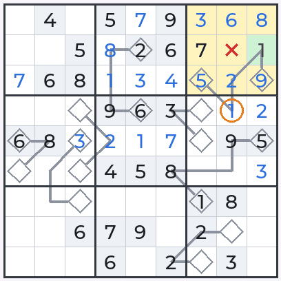

<!-- Written by tools/walkthrough.py lockout-lines: edit the script, not this page. -->
# Lockout Lines, step 20: the 1 in box 3

**Step 20 of 53** · [← Step 19](step-19.md) · [All steps](../lockout-lines.md#the-whole-puzzle-step-by-step) · [Step 21 →](step-21.md)

Box 3 needs a 1. r2c8: column 8 has one (r4c8). Only **r2c9** is left: **r2c9 = 1**.

**Step 20 of 53** · [← Step 19](step-19.md) · [All steps](../lockout-lines.md#the-whole-puzzle-step-by-step) · [Step 21 →](step-21.md)
