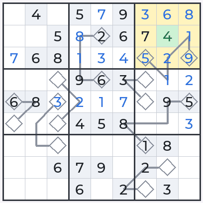

<!-- Written by tools/walkthrough.py lockout-lines: edit the script, not this page. -->
# Lockout Lines, step 21: the 4 in box 3

**Step 21 of 53** · [← Step 20](step-20.md) · [All steps](../lockout-lines.md#the-whole-puzzle-step-by-step) · [Step 22 →](step-22.md)

Box 3 needs a 4, and r2c8 is its last empty cell: **r2c8 = 4**.

**Step 21 of 53** · [← Step 20](step-20.md) · [All steps](../lockout-lines.md#the-whole-puzzle-step-by-step) · [Step 22 →](step-22.md)
