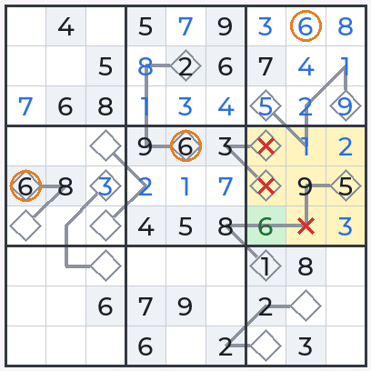

<!-- Written by tools/walkthrough.py lockout-lines: edit the script, not this page. -->
# Lockout Lines, step 22: the 6 in box 6

**Step 22 of 53** · [← Step 21](step-21.md) · [All steps](../lockout-lines.md#the-whole-puzzle-step-by-step) · [Step 23 →](step-23.md)

Box 6 needs a 6. r4c7: row 4 has one (r4c5). r5c7: row 5 has one (r5c1). r6c8: column 8 has one (r1c8). Only **r6c7** is left: **r6c7 = 6**.

**Step 22 of 53** · [← Step 21](step-21.md) · [All steps](../lockout-lines.md#the-whole-puzzle-step-by-step) · [Step 23 →](step-23.md)
