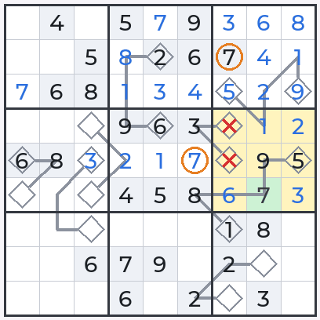

<!-- Written by tools/walkthrough.py lockout-lines: edit the script, not this page. -->
# Lockout Lines, step 23: the 7 in box 6

**Step 23 of 53** · [← Step 22](step-22.md) · [All steps](../lockout-lines.md#the-whole-puzzle-step-by-step) · [Step 24 →](step-24.md)

Box 6 needs a 7. r4c7: column 7 has one (r2c7). r5c7: row 5 has one (r5c6). Only **r6c8** is left: **r6c8 = 7**.

**Step 23 of 53** · [← Step 22](step-22.md) · [All steps](../lockout-lines.md#the-whole-puzzle-step-by-step) · [Step 24 →](step-24.md)
