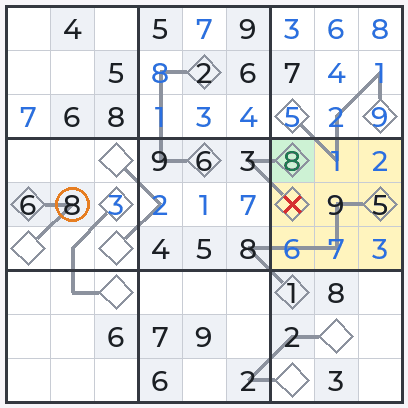

<!-- Written by tools/walkthrough.py lockout-lines: edit the script, not this page. -->
# Lockout Lines, step 24: the 8 in box 6

**Step 24 of 53** · [← Step 23](step-23.md) · [All steps](../lockout-lines.md#the-whole-puzzle-step-by-step) · [Step 25 →](step-25.md)

Box 6 needs an 8. r5c7: row 5 has one (r5c2). Only **r4c7** is left: **r4c7 = 8**.

**Step 24 of 53** · [← Step 23](step-23.md) · [All steps](../lockout-lines.md#the-whole-puzzle-step-by-step) · [Step 25 →](step-25.md)
