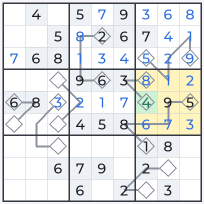

<!-- Written by tools/walkthrough.py lockout-lines: edit the script, not this page. -->
# Lockout Lines, step 25: the 4 in box 6

**Step 25 of 53** · [← Step 24](step-24.md) · [All steps](../lockout-lines.md#the-whole-puzzle-step-by-step) · [Step 26 →](step-26.md)

Box 6 needs a 4, and r5c7 is its last empty cell: **r5c7 = 4**.

**Step 25 of 53** · [← Step 24](step-24.md) · [All steps](../lockout-lines.md#the-whole-puzzle-step-by-step) · [Step 26 →](step-26.md)
