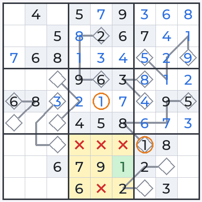

<!-- Written by tools/walkthrough.py lockout-lines: edit the script, not this page. -->
# Lockout Lines, step 26: the 1 in box 8

**Step 26 of 53** · [← Step 25](step-25.md) · [All steps](../lockout-lines.md#the-whole-puzzle-step-by-step) · [Step 27 →](step-27.md)

Box 8 needs a 1. r7c4, r7c5 and r7c6: row 7 has one (r7c7). r9c5: column 5 has one (r5c5). Only **r8c6** is left: **r8c6 = 1**.

**Step 26 of 53** · [← Step 25](step-25.md) · [All steps](../lockout-lines.md#the-whole-puzzle-step-by-step) · [Step 27 →](step-27.md)
