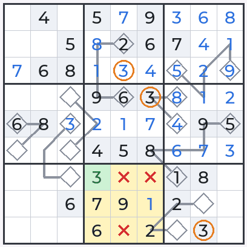

<!-- Written by tools/walkthrough.py lockout-lines: edit the script, not this page. -->
# Lockout Lines, step 27: the 3 in box 8

**Step 27 of 53** · [← Step 26](step-26.md) · [All steps](../lockout-lines.md#the-whole-puzzle-step-by-step) · [Step 28 →](step-28.md)

Box 8 needs a 3. r7c5: column 5 has one (r3c5). r7c6: column 6 has one (r4c6). r9c5: row 9 has one (r9c8). Only **r7c4** is left: **r7c4 = 3**.

**Step 27 of 53** · [← Step 26](step-26.md) · [All steps](../lockout-lines.md#the-whole-puzzle-step-by-step) · [Step 28 →](step-28.md)
