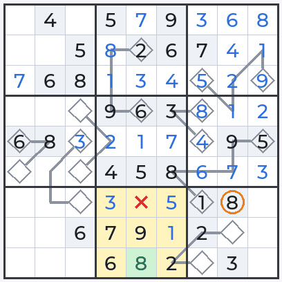

<!-- Written by tools/walkthrough.py lockout-lines: edit the script, not this page. -->
# Lockout Lines, step 29: the 8 in box 8

**Step 29 of 53** · [← Step 28](step-28.md) · [All steps](../lockout-lines.md#the-whole-puzzle-step-by-step) · [Step 30 →](step-30.md)

Box 8 needs an 8. r7c5: row 7 has one (r7c8). Only **r9c5** is left: **r9c5 = 8**.

**Step 29 of 53** · [← Step 28](step-28.md) · [All steps](../lockout-lines.md#the-whole-puzzle-step-by-step) · [Step 30 →](step-30.md)
