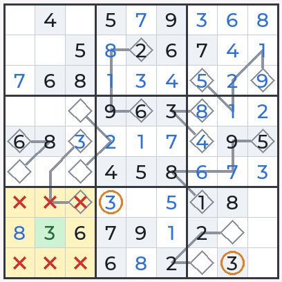

<!-- Written by tools/walkthrough.py lockout-lines: edit the script, not this page. -->
# Lockout Lines, step 31: the 3 in box 7

**Step 31 of 53** · [← Step 30](step-30.md) · [All steps](../lockout-lines.md#the-whole-puzzle-step-by-step) · [Step 32 →](step-32.md)

Box 7 needs a 3. r7c1, r7c2 and r7c3: row 7 has one (r7c4). r9c1, r9c2 and r9c3: row 9 has one (r9c8). Only **r8c2** is left: **r8c2 = 3**.

**Step 31 of 53** · [← Step 30](step-30.md) · [All steps](../lockout-lines.md#the-whole-puzzle-step-by-step) · [Step 32 →](step-32.md)
