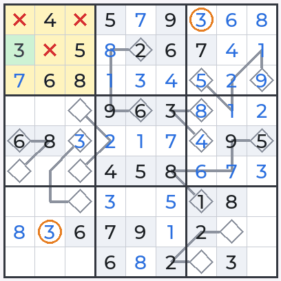

<!-- Written by tools/walkthrough.py lockout-lines: edit the script, not this page. -->
# Lockout Lines, step 32: the 3 in box 1

**Step 32 of 53** · [← Step 31](step-31.md) · [All steps](../lockout-lines.md#the-whole-puzzle-step-by-step) · [Step 33 →](step-33.md)

Box 1 needs a 3. r1c1 and r1c3: row 1 has one (r1c7). r2c2: column 2 has one (r8c2). Only **r2c1** is left: **r2c1 = 3**.

**Step 32 of 53** · [← Step 31](step-31.md) · [All steps](../lockout-lines.md#the-whole-puzzle-step-by-step) · [Step 33 →](step-33.md)
