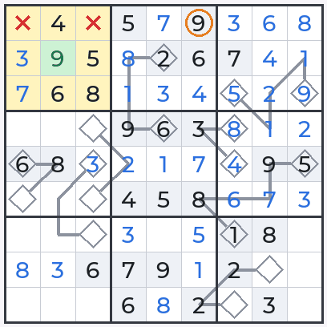

<!-- Written by tools/walkthrough.py lockout-lines: edit the script, not this page. -->
# Lockout Lines, step 33: the 9 in box 1

**Step 33 of 53** · [← Step 32](step-32.md) · [All steps](../lockout-lines.md#the-whole-puzzle-step-by-step) · [Step 34 →](step-34.md)

Box 1 needs a 9. r1c1 and r1c3: row 1 has one (r1c6). Only **r2c2** is left: **r2c2 = 9**.

**Step 33 of 53** · [← Step 32](step-32.md) · [All steps](../lockout-lines.md#the-whole-puzzle-step-by-step) · [Step 34 →](step-34.md)
