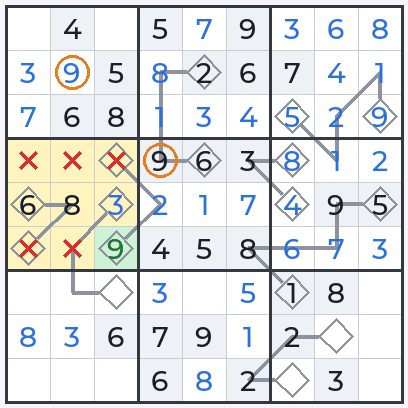

<!-- Written by tools/walkthrough.py lockout-lines: edit the script, not this page. -->
# Lockout Lines, step 34: the 9 in box 4

**Step 34 of 53** · [← Step 33](step-33.md) · [All steps](../lockout-lines.md#the-whole-puzzle-step-by-step) · [Step 35 →](step-35.md)

Box 4 needs a 9. r4c1, r4c2 and r4c3: row 4 has one (r4c4). r6c2: column 2 has one (r2c2). r6c1: it's a diamond, and a 9 is less than 4 away from the 6 in the other diamond. Only **r6c3** is left: **r6c3 = 9**.

**Step 34 of 53** · [← Step 33](step-33.md) · [All steps](../lockout-lines.md#the-whole-puzzle-step-by-step) · [Step 35 →](step-35.md)
