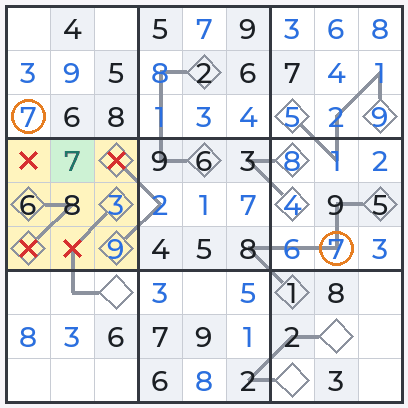

<!-- Written by tools/walkthrough.py lockout-lines: edit the script, not this page. -->
# Lockout Lines, step 35: the 7 in box 4

**Step 35 of 53** · [← Step 34](step-34.md) · [All steps](../lockout-lines.md#the-whole-puzzle-step-by-step) · [Step 36 →](step-36.md)

Box 4 needs a 7. r4c1: column 1 has one (r3c1). r6c1 and r6c2: row 6 has one (r6c8). r4c3: it's a diamond, and a 7 is less than 4 away from the 9 in the other diamond. Only **r4c2** is left: **r4c2 = 7**.

**Step 35 of 53** · [← Step 34](step-34.md) · [All steps](../lockout-lines.md#the-whole-puzzle-step-by-step) · [Step 36 →](step-36.md)
