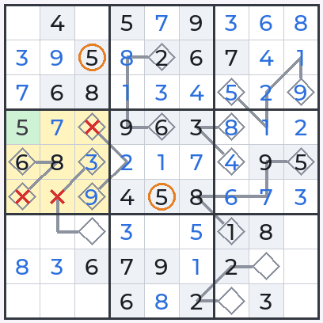

<!-- Written by tools/walkthrough.py lockout-lines: edit the script, not this page. -->
# Lockout Lines, step 36: the 5 in box 4

**Step 36 of 53** · [← Step 35](step-35.md) · [All steps](../lockout-lines.md#the-whole-puzzle-step-by-step) · [Step 37 →](step-37.md)

Box 4 needs a 5. r4c3: column 3 has one (r2c3). r6c1 and r6c2: row 6 has one (r6c5). Only **r4c1** is left: **r4c1 = 5**.

**Step 36 of 53** · [← Step 35](step-35.md) · [All steps](../lockout-lines.md#the-whole-puzzle-step-by-step) · [Step 37 →](step-37.md)
