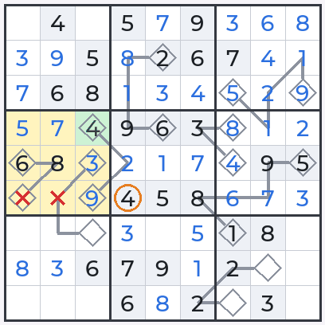

<!-- Written by tools/walkthrough.py lockout-lines: edit the script, not this page. -->
# Lockout Lines, step 37: the 4 in box 4

**Step 37 of 53** · [← Step 36](step-36.md) · [All steps](../lockout-lines.md#the-whole-puzzle-step-by-step) · [Step 38 →](step-38.md)

Box 4 needs a 4. r6c1 and r6c2: row 6 has one (r6c4). Only **r4c3** is left: **r4c3 = 4**.

**Step 37 of 53** · [← Step 36](step-36.md) · [All steps](../lockout-lines.md#the-whole-puzzle-step-by-step) · [Step 38 →](step-38.md)
