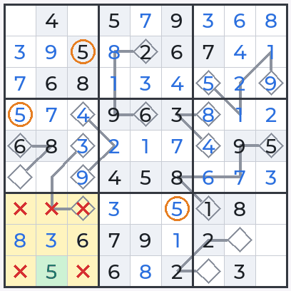

<!-- Written by tools/walkthrough.py lockout-lines: edit the script, not this page. -->
# Lockout Lines, step 38: the 5 in box 7

**Step 38 of 53** · [← Step 37](step-37.md) · [All steps](../lockout-lines.md#the-whole-puzzle-step-by-step) · [Step 39 →](step-39.md)

Box 7 needs a 5. r7c1, r7c2 and r7c3: row 7 has one (r7c6). r9c1: column 1 has one (r4c1). r9c3: column 3 has one (r2c3). Only **r9c2** is left: **r9c2 = 5**.

**Step 38 of 53** · [← Step 37](step-37.md) · [All steps](../lockout-lines.md#the-whole-puzzle-step-by-step) · [Step 39 →](step-39.md)
