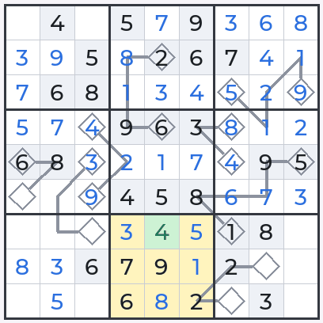

<!-- Written by tools/walkthrough.py lockout-lines: edit the script, not this page. -->
# Lockout Lines, step 39: the 4 in box 8

**Step 39 of 53** · [← Step 38](step-38.md) · [All steps](../lockout-lines.md#the-whole-puzzle-step-by-step) · [Step 40 →](step-40.md)

Box 8 needs a 4, and r7c5 is its last empty cell: **r7c5 = 4**.

**Step 39 of 53** · [← Step 38](step-38.md) · [All steps](../lockout-lines.md#the-whole-puzzle-step-by-step) · [Step 40 →](step-40.md)
