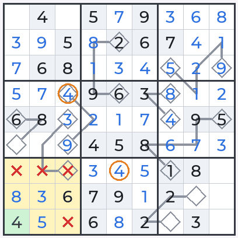

<!-- Written by tools/walkthrough.py lockout-lines: edit the script, not this page. -->
# Lockout Lines, step 40: the 4 in box 7

**Step 40 of 53** · [← Step 39](step-39.md) · [All steps](../lockout-lines.md#the-whole-puzzle-step-by-step) · [Step 41 →](step-41.md)

Box 7 needs a 4. r7c1, r7c2 and r7c3: row 7 has one (r7c5). r9c3: column 3 has one (r4c3). Only **r9c1** is left: **r9c1 = 4**.

**Step 40 of 53** · [← Step 39](step-39.md) · [All steps](../lockout-lines.md#the-whole-puzzle-step-by-step) · [Step 41 →](step-41.md)
