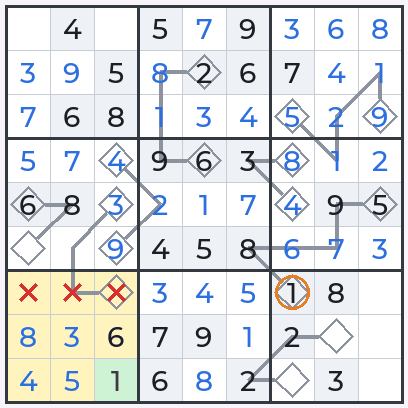

<!-- Written by tools/walkthrough.py lockout-lines: edit the script, not this page. -->
# Lockout Lines, step 41: the 1 in box 7

**Step 41 of 53** · [← Step 40](step-40.md) · [All steps](../lockout-lines.md#the-whole-puzzle-step-by-step) · [Step 42 →](step-42.md)

Box 7 needs a 1. r7c1, r7c2 and r7c3: row 7 has one (r7c7). Only **r9c3** is left: **r9c3 = 1**.

**Step 41 of 53** · [← Step 40](step-40.md) · [All steps](../lockout-lines.md#the-whole-puzzle-step-by-step) · [Step 42 →](step-42.md)
