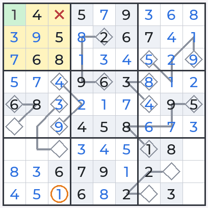

<!-- Written by tools/walkthrough.py lockout-lines: edit the script, not this page. -->
# Lockout Lines, step 42: the 1 in box 1

**Step 42 of 53** · [← Step 41](step-41.md) · [All steps](../lockout-lines.md#the-whole-puzzle-step-by-step) · [Step 43 →](step-43.md)

Box 1 needs a 1. r1c3: column 3 has one (r9c3). Only **r1c1** is left: **r1c1 = 1**.

**Step 42 of 53** · [← Step 41](step-41.md) · [All steps](../lockout-lines.md#the-whole-puzzle-step-by-step) · [Step 43 →](step-43.md)
