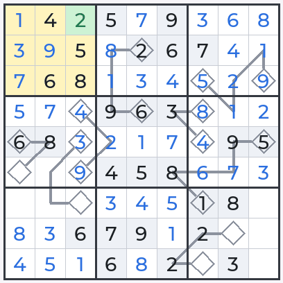

<!-- Written by tools/walkthrough.py lockout-lines: edit the script, not this page. -->
# Lockout Lines, step 43: the 2 in box 1

**Step 43 of 53** · [← Step 42](step-42.md) · [All steps](../lockout-lines.md#the-whole-puzzle-step-by-step) · [Step 44 →](step-44.md)

Box 1 needs a 2, and r1c3 is its last empty cell: **r1c3 = 2**.

**Step 43 of 53** · [← Step 42](step-42.md) · [All steps](../lockout-lines.md#the-whole-puzzle-step-by-step) · [Step 44 →](step-44.md)
