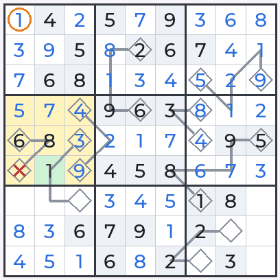

<!-- Written by tools/walkthrough.py lockout-lines: edit the script, not this page. -->
# Lockout Lines, step 44: the 1 in box 4

**Step 44 of 53** · [← Step 43](step-43.md) · [All steps](../lockout-lines.md#the-whole-puzzle-step-by-step) · [Step 45 →](step-45.md)

Box 4 needs a 1. r6c1: column 1 has one (r1c1). Only **r6c2** is left: **r6c2 = 1**.

**Step 44 of 53** · [← Step 43](step-43.md) · [All steps](../lockout-lines.md#the-whole-puzzle-step-by-step) · [Step 45 →](step-45.md)
