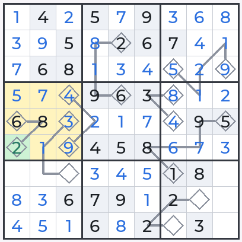

<!-- Written by tools/walkthrough.py lockout-lines: edit the script, not this page. -->
# Lockout Lines, step 45: the 2 in box 4

**Step 45 of 53** · [← Step 44](step-44.md) · [All steps](../lockout-lines.md#the-whole-puzzle-step-by-step) · [Step 46 →](step-46.md)

Box 4 needs a 2, and r6c1 is its last empty cell: **r6c1 = 2**.

**Step 45 of 53** · [← Step 44](step-44.md) · [All steps](../lockout-lines.md#the-whole-puzzle-step-by-step) · [Step 46 →](step-46.md)
