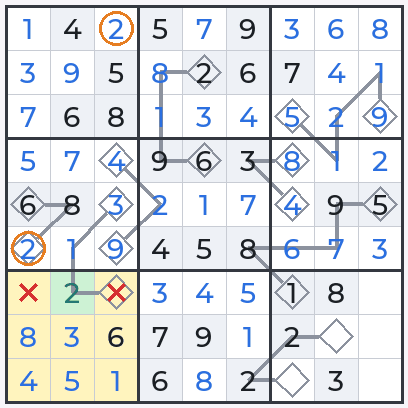

<!-- Written by tools/walkthrough.py lockout-lines: edit the script, not this page. -->
# Lockout Lines, step 46: the 2 in box 7

**Step 46 of 53** · [← Step 45](step-45.md) · [All steps](../lockout-lines.md#the-whole-puzzle-step-by-step) · [Step 47 →](step-47.md)

Box 7 needs a 2. r7c1: column 1 has one (r6c1). r7c3: column 3 has one (r1c3). Only **r7c2** is left: **r7c2 = 2**.

**Step 46 of 53** · [← Step 45](step-45.md) · [All steps](../lockout-lines.md#the-whole-puzzle-step-by-step) · [Step 47 →](step-47.md)
