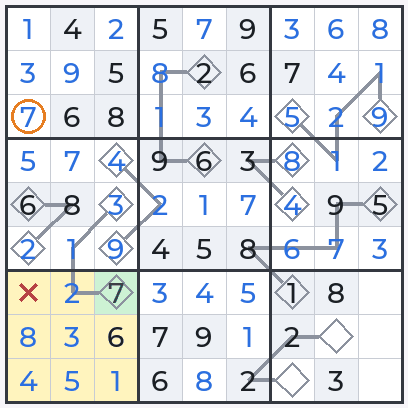

<!-- Written by tools/walkthrough.py lockout-lines: edit the script, not this page. -->
# Lockout Lines, step 47: the 7 in box 7

**Step 47 of 53** · [← Step 46](step-46.md) · [All steps](../lockout-lines.md#the-whole-puzzle-step-by-step) · [Step 48 →](step-48.md)

Box 7 needs a 7. r7c1: column 1 has one (r3c1). Only **r7c3** is left: **r7c3 = 7**.

**Step 47 of 53** · [← Step 46](step-46.md) · [All steps](../lockout-lines.md#the-whole-puzzle-step-by-step) · [Step 48 →](step-48.md)
