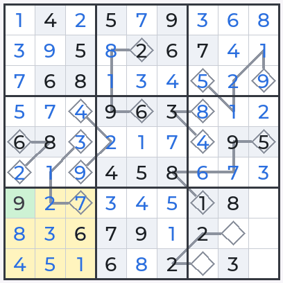

<!-- Written by tools/walkthrough.py lockout-lines: edit the script, not this page. -->
# Lockout Lines, step 48: the 9 in box 7

**Step 48 of 53** · [← Step 47](step-47.md) · [All steps](../lockout-lines.md#the-whole-puzzle-step-by-step) · [Step 49 →](step-49.md)

Box 7 needs a 9, and r7c1 is its last empty cell: **r7c1 = 9**.

**Step 48 of 53** · [← Step 47](step-47.md) · [All steps](../lockout-lines.md#the-whole-puzzle-step-by-step) · [Step 49 →](step-49.md)
