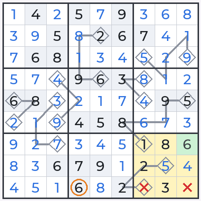

<!-- Written by tools/walkthrough.py lockout-lines: edit the script, not this page. -->
# Lockout Lines, step 51: the 6 in box 9

**Step 51 of 53** · [← Step 50](step-50.md) · [All steps](../lockout-lines.md#the-whole-puzzle-step-by-step) · [Step 52 →](step-52.md)

Box 9 needs a 6. r9c7 and r9c9: row 9 has one (r9c4). Only **r7c9** is left: **r7c9 = 6**.

**Step 51 of 53** · [← Step 50](step-50.md) · [All steps](../lockout-lines.md#the-whole-puzzle-step-by-step) · [Step 52 →](step-52.md)
