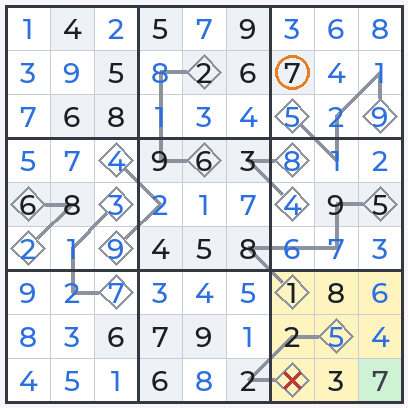

<!-- Written by tools/walkthrough.py lockout-lines: edit the script, not this page. -->
# Lockout Lines, step 52: the 7 in box 9

**Step 52 of 53** · [← Step 51](step-51.md) · [All steps](../lockout-lines.md#the-whole-puzzle-step-by-step) · [Step 53 →](step-53.md)

Box 9 needs a 7. r9c7: column 7 has one (r2c7). Only **r9c9** is left: **r9c9 = 7**.

**Step 52 of 53** · [← Step 51](step-51.md) · [All steps](../lockout-lines.md#the-whole-puzzle-step-by-step) · [Step 53 →](step-53.md)
