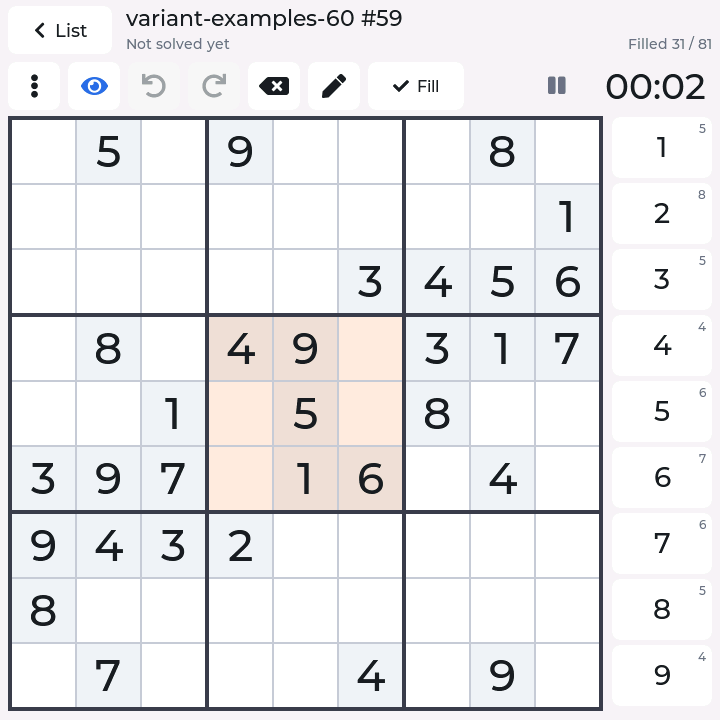
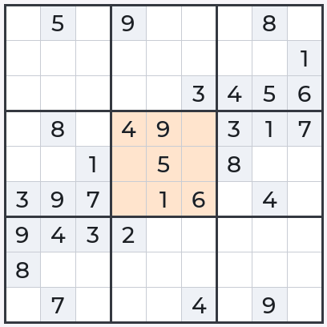

# Magic Square

[← All variants](README.md) · [Puzzles](../features-puzzles.md) · [How to play](../how-to-play.md)

## The rules

[Classic](classic.md) rules, and the **centre box** (tinted) is a **magic square**: each of its three rows, three columns and two diagonals adds up to **15**.

There's only one magic square of the digits 1 to 9, turned or flipped (the Lo Shu): **5 in the middle**, **even digits in the corners** (2, 4, 6, 8) and **odd ones on the edges** (1, 3, 7, 9), each pair across the middle adding up to 10.

## On the board

- The centre box is tinted.
- A full row, column or diagonal of it that doesn't make 15 turns red.
- The middle starts as a 5 in all but name: the board allows only 5 there, even corners and odd edges.
- The grader and hints: "The centre box is a magic square: each of its rows, columns and diagonals adds up to 15, so row 5, column 6 can only be 7."
- **Puzzles → ⋮ → New puzzle → Grids → Magic Square.**

## How to solve it

- **The middle is 5.** Then opposite cells make 10: 2 and 8, 4 and 6 in the corners, 1 and 9, 3 and 7 on the edges.
- **One corner fixes the box:** with 2 top left, 8 is bottom right, and the 2's row and column are 2, 7, 6 and 2, 9, 4, one each way: the square is 2 7 6 / 9 5 1 / 4 3 8, or that flipped.
- **Outside the box,** the square's digits work like any givens: a 7 on the box's right edge is a 7 for its row and column.

## Worked example

**variant-examples #59**, Magic Square Easy (see [Classic](classic.md#worked-example-the-whole-puzzle) for how to import the examples; cells are written r*row*c*column*).

**Step 1: r5c6.** Row 5 has 1, 5 and 8; column 6 has 3, 4 and 6; box 5 has 9: that leaves 2 and 7. r5c6 is on the edge of the magic square (the middle of its right column), and edges are odd. **r5c6 = 7** (and r5c4, across the middle, is 3: 3 + 5 + 7 = 15).

**Steps 2 and 3** are Classic hidden singles: the 3 in box 1 (**r2c2**), then the 3 in box 3 (**r1c9**).

## The whole puzzle, step by step

<!-- walkthrough -->
<!-- Written by tools/walkthrough.py magic-square: edit the script, not this part. -->

The whole puzzle, from the start to the last cell: 50 steps, each one a single (one place left for a digit, or one digit left for a cell), taken in the order a box's single comes first, so not quite the order of the worked example above. Each step has a page of its own, with **Previous** and **Next**: pick one from the list below. In each picture, the unit the step looks at is tinted yellow (for a cell with one digit left: its row, column and box), the new digit is on green, the digits that rule cells out have an **orange ring**, and the empty cells they rule out a **red cross**. Givens are on grey, digits from earlier steps in blue.

1. [the 3 in box 1](magic-square/step-01.md)
2. [the 3 in box 3](magic-square/step-02.md)
3. [the 9 in box 3](magic-square/step-03.md)
4. [the 9 in box 1](magic-square/step-04.md)
5. [the 8 in box 1](magic-square/step-05.md)
6. [the 4 in box 4](magic-square/step-06.md)
7. [the 4 in box 1](magic-square/step-07.md)
8. [the 4 in box 2](magic-square/step-08.md)
9. [the 2 in box 5](magic-square/step-09.md)
10. [the 2 in box 4](magic-square/step-10.md)
11. [the 3 in box 5](magic-square/step-11.md)
12. [the 7 in box 5](magic-square/step-12.md)
13. [the 8 in box 5](magic-square/step-13.md)
14. [the 8 in box 2](magic-square/step-14.md)
15. [the 2 in box 2](magic-square/step-15.md)
16. [the 6 in box 2](magic-square/step-16.md)
17. [the 6 in box 1](magic-square/step-17.md)
18. [the 5 in box 2](magic-square/step-18.md)
19. [the 7 in box 2](magic-square/step-19.md)
20. [the 7 in box 1](magic-square/step-20.md)
21. [the 2 in box 1](magic-square/step-21.md)
22. [the 1 in box 1](magic-square/step-22.md)
23. [the 1 in box 2](magic-square/step-23.md)
24. [the 2 in box 3](magic-square/step-24.md)
25. [the 7 in box 3](magic-square/step-25.md)
26. [the 6 in box 4](magic-square/step-26.md)
27. [the 5 in box 4](magic-square/step-27.md)
28. [the 6 in box 6](magic-square/step-28.md)
29. [the 9 in box 6](magic-square/step-29.md)
30. [the 1 in box 7](magic-square/step-30.md)
31. [the 6 in box 7](magic-square/step-31.md)
32. [the 1 in box 8](magic-square/step-32.md)
33. [the 5 in box 8](magic-square/step-33.md)
34. [the 5 in box 7](magic-square/step-34.md)
35. [the 2 in box 7](magic-square/step-35.md)
36. [the 8 in box 8](magic-square/step-36.md)
37. [the 9 in box 8](magic-square/step-37.md)
38. [the 1 in box 9](magic-square/step-38.md)
39. [the 3 in box 9](magic-square/step-39.md)
40. [the 3 in box 8](magic-square/step-40.md)
41. [the 6 in box 8](magic-square/step-41.md)
42. [the 7 in box 8](magic-square/step-42.md)
43. [the 4 in box 9](magic-square/step-43.md)
44. [the 2 in box 9](magic-square/step-44.md)
45. [the 2 in box 6](magic-square/step-45.md)
46. [the 5 in box 6](magic-square/step-46.md)
47. [the 5 in box 9](magic-square/step-47.md)
48. [the 6 in box 9](magic-square/step-48.md)
49. [the 7 in box 9](magic-square/step-49.md)
50. [the 8 in box 9](magic-square/step-50.md)

Solved.

<!-- /walkthrough -->
