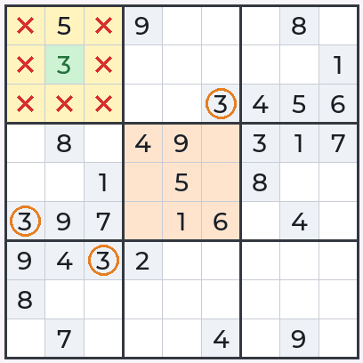

<!-- Written by tools/walkthrough.py magic-square: edit the script, not this page. -->
# Magic Square, step 1: the 3 in box 1

**Step 1 of 50** · [← The start](../magic-square.md#the-whole-puzzle-step-by-step) · [All steps](../magic-square.md#the-whole-puzzle-step-by-step) · [Step 2 →](step-02.md)

Box 1 needs a 3. r1c1 and r2c1: column 1 has one (r6c1). r1c3 and r2c3: column 3 has one (r7c3). r3c1, r3c2 and r3c3: row 3 has one (r3c6). Only **r2c2** is left: **r2c2 = 3**.

**Step 1 of 50** · [← The start](../magic-square.md#the-whole-puzzle-step-by-step) · [All steps](../magic-square.md#the-whole-puzzle-step-by-step) · [Step 2 →](step-02.md)
