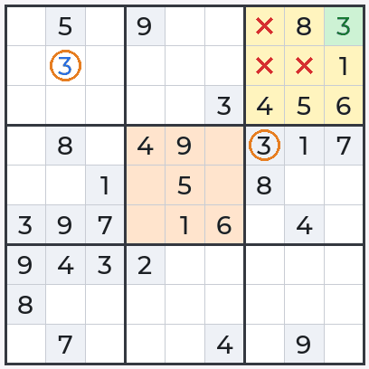

<!-- Written by tools/walkthrough.py magic-square: edit the script, not this page. -->
# Magic Square, step 2: the 3 in box 3

**Step 2 of 50** · [← Step 1](step-01.md) · [All steps](../magic-square.md#the-whole-puzzle-step-by-step) · [Step 3 →](step-03.md)

Box 3 needs a 3. r1c7: column 7 has one (r4c7). r2c7 and r2c8: row 2 has one (r2c2). Only **r1c9** is left: **r1c9 = 3**.

**Step 2 of 50** · [← Step 1](step-01.md) · [All steps](../magic-square.md#the-whole-puzzle-step-by-step) · [Step 3 →](step-03.md)
