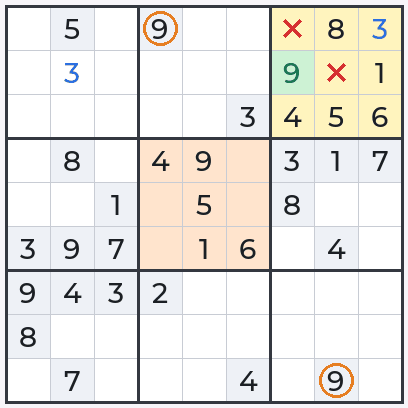

<!-- Written by tools/walkthrough.py magic-square: edit the script, not this page. -->
# Magic Square, step 3: the 9 in box 3

**Step 3 of 50** · [← Step 2](step-02.md) · [All steps](../magic-square.md#the-whole-puzzle-step-by-step) · [Step 4 →](step-04.md)

Box 3 needs a 9. r1c7: row 1 has one (r1c4). r2c8: column 8 has one (r9c8). Only **r2c7** is left: **r2c7 = 9**.

**Step 3 of 50** · [← Step 2](step-02.md) · [All steps](../magic-square.md#the-whole-puzzle-step-by-step) · [Step 4 →](step-04.md)
