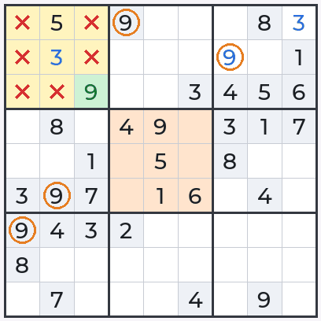

<!-- Written by tools/walkthrough.py magic-square: edit the script, not this page. -->
# Magic Square, step 4: the 9 in box 1

**Step 4 of 50** · [← Step 3](step-03.md) · [All steps](../magic-square.md#the-whole-puzzle-step-by-step) · [Step 5 →](step-05.md)

Box 1 needs a 9. r1c1 and r1c3: row 1 has one (r1c4). r2c1 and r2c3: row 2 has one (r2c7). r3c1: column 1 has one (r7c1). r3c2: column 2 has one (r6c2). Only **r3c3** is left: **r3c3 = 9**.

**Step 4 of 50** · [← Step 3](step-03.md) · [All steps](../magic-square.md#the-whole-puzzle-step-by-step) · [Step 5 →](step-05.md)
