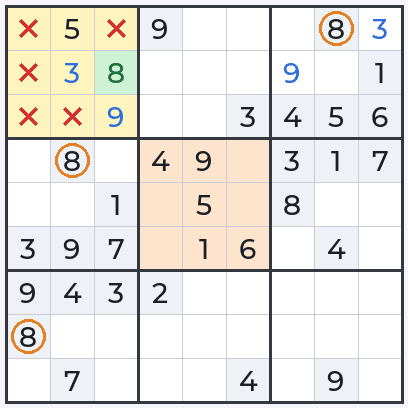

<!-- Written by tools/walkthrough.py magic-square: edit the script, not this page. -->
# Magic Square, step 5: the 8 in box 1

**Step 5 of 50** · [← Step 4](step-04.md) · [All steps](../magic-square.md#the-whole-puzzle-step-by-step) · [Step 6 →](step-06.md)

Box 1 needs an 8. r1c1 and r1c3: row 1 has one (r1c8). r2c1 and r3c1: column 1 has one (r8c1). r3c2: column 2 has one (r4c2). Only **r2c3** is left: **r2c3 = 8**.

**Step 5 of 50** · [← Step 4](step-04.md) · [All steps](../magic-square.md#the-whole-puzzle-step-by-step) · [Step 6 →](step-06.md)
