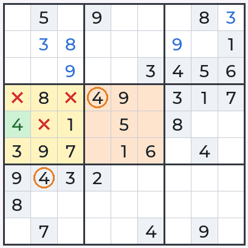

<!-- Written by tools/walkthrough.py magic-square: edit the script, not this page. -->
# Magic Square, step 6: the 4 in box 4

**Step 6 of 50** · [← Step 5](step-05.md) · [All steps](../magic-square.md#the-whole-puzzle-step-by-step) · [Step 7 →](step-07.md)

Box 4 needs a 4. r4c1 and r4c3: row 4 has one (r4c4). r5c2: column 2 has one (r7c2). Only **r5c1** is left: **r5c1 = 4**.

**Step 6 of 50** · [← Step 5](step-05.md) · [All steps](../magic-square.md#the-whole-puzzle-step-by-step) · [Step 7 →](step-07.md)
