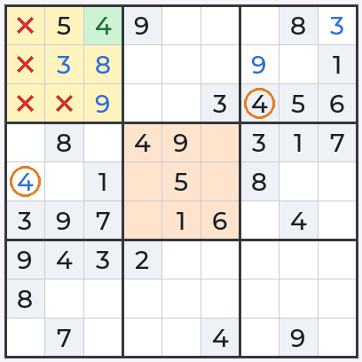

<!-- Written by tools/walkthrough.py magic-square: edit the script, not this page. -->
# Magic Square, step 7: the 4 in box 1

**Step 7 of 50** · [← Step 6](step-06.md) · [All steps](../magic-square.md#the-whole-puzzle-step-by-step) · [Step 8 →](step-08.md)

Box 1 needs a 4. r1c1 and r2c1: column 1 has one (r5c1). r3c1 and r3c2: row 3 has one (r3c7). Only **r1c3** is left: **r1c3 = 4**.

**Step 7 of 50** · [← Step 6](step-06.md) · [All steps](../magic-square.md#the-whole-puzzle-step-by-step) · [Step 8 →](step-08.md)
